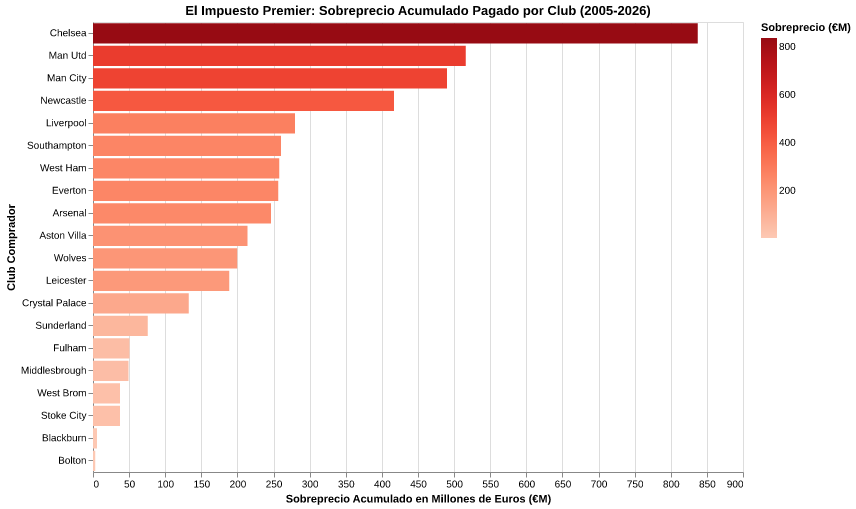

# "Impuesto Premier", ¿mito o realidad?

En las oficinas deportivas del fútbol europeo existe una regla no escrita que todo director deportivo conoce de memoria: si quien toca a la puerta habla inglés con acento británico, la cotización de cualquier futbolista se multiplica automáticamente antes de descolgar el teléfono. No es un mito de vestuario ni una exageración de la prensa deportiva inglesa. Los números de más de dos décadas de transferencias revelan una distorsión estructural: el "Impuesto Premier", una prima monetaria que convierte al torneo más rico del planeta en la liga más sistemáticamente ineficiente a la hora de pagar por el talento que que atraen al pagar sistemáticamente bastante mas por los jugadores adquiridos de la tasación del mercado.

Entre 2004 y 2026, los 20 clubes más estables del fútbol inglés desembolsaron más de 19.800 millones de euros en 997 operaciones de compra analizadas, según datos de Transfermarkt. Sin embargo, la tasación técnica estimada de esos mismos jugadores al momento de concretarse los acuerdos rondaba apenas los 15.280 millones de euros. La brecha resultante es demoledora: más de 4.555 millones de euros pagados íntegramente en calidad de sobreprecio neto. Es decir, casi un tercio del dinero invertido por el fútbol británico (un 29,8% de recargo acumulado) se esfumó en primas de urgencia y cláusulas infladas por la liquidez sin fondo de los lucrativos derechos televisivos.

La visualización de datos desnuda las dimensiones de este fenómeno institución por institución. En la cúspide del gasto desmedido se erige el Chelsea FC. Con una política de contrataciones compulsiva que se aceleró exponencialmente en el último lustro, el club londinense acumula en solitario un sobreprecio de 837,2 millones de euros a lo largo de 93 traspasos. Pagaron más de 3.000 millones de euros por un lote de futbolistas tasado objetivamente en algo más de 2.000 millones.

Apenas un peldaño más abajo aparece el Manchester United, cuyo patrón de gasto confirma cómo el exceso de capital no garantiza acierto deportivo. Aunque ocupan el segundo lugar en sobreprecio acumulado absoluto (€516 millones adicionales), su recargo porcentual promedio es el más alto entre las grandes potencias de la liga. Desde apuestas juveniles hiperinfladas hasta fichajes de renombre internacional cerrados en el límite del libro de pases, los "Red Devils" han pagado casi el triple de la tasación objetiva de mercado para mejorar su plantel, y si eso fuera poco, esto no le ha traído siquiera buenos resultados, pues llevan mas de 15 años sin ganar la Premier League.

Pero la anomalía no pertenece en exclusiva al autodenominado *Big Six*. La gráfica expone una verdad aún más reveladora para la mitad de la tabla: clubes como Newcastle United (€416,8M de sobreprecio acumulado tras la inyección saudí), Southampton (€260,2M) o Everton (€256,4M con un sobreprecio promedio de 182,2%) registran desviaciones porcentuales tanto o más severas que las de los contendientes al título. Para estas escuadras, el sobrepago no es una demostración de opulencia, sino un impuesto de supervivencia: el precio extorsivo exigido por las ligas extranjeras a sabiendas de que perder la categoría en Inglaterra implica un abismo económico del que pocos logran retornar a pesar de los fondos paracaídas que ofrece la liga a los descendidos.

El fútbol inglés no solo compra futbolistas; financia, con su propio superávit, la inflación del mercado continental. Pues, si un equipo en Alemania tiene un jugador valorado en 20 millones, porque se lo vendería a un equipo español o italiano por esa cifra cuando puede ganar 10 millones mas facilmente si el comprador viene de Inglaterra.
